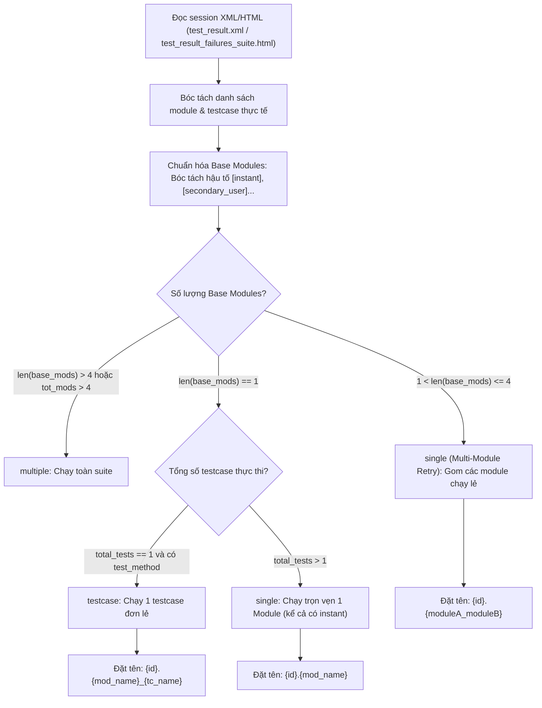
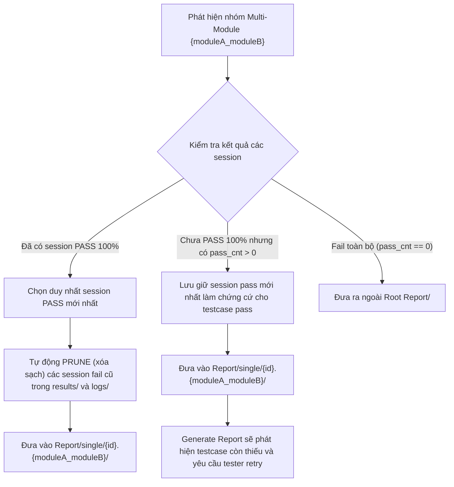

# ĐẶC TẢ KIẾN TRÚC & QUY CHUẨN THU THẬP BÁO CÁO (COLLECT REPORT MODE)
> **Tài liệu tham chiếu chuẩn** cho công cụ `xTS Tool` (`report_collector.py`)  
> **Phiên bản:** v2.1 (Cập nhật phân loại Data-driven, hỗ trợ Instant Modules và Multi-Module Targeted Retries)

---

## 1. Cấu Trúc Cây Thư Mục Báo Cáo Chuẩn (`Report/`)

Cấu trúc đích được sinh ra tại `<test_root>/Report/` tuân thủ nghiêm ngặt mô hình phân tách **Root (Multiple & Chưa Pass)** và **`single/` (Đã Pass hoặc có chứng cứ Testcase Pass)**:

```text
<test_root>/Report/
├── results/                                     # Dữ liệu session Multiple (đã lọc 2 đầu + 2 cuối)
│   ├── 2026.10.20_10.00.00/
│   └── 2026.10.20_10.00.00.zip
├── logs/                                        # Log tương ứng của session Multiple
│   └── 2026.10.20_10.00.00/
│
├── single/                                      # [KHU VỰC CHỨA CHỨNG CỨ PASS]
│   ├── 01.CtsAppTestCases/                      # Module đơn lẻ retry đã PASS (hỗ trợ cả variant [instant])
│   │   ├── results/
│   │   └── logs/
│   ├── 02.CtsCarTestCases_CtsWifiTestCases/     # Targeted Multi-Module retry (chứa case pass, tự prune session fail cũ)
│   │   ├── results/
│   │   └── logs/
│   └── 03.CtsWifiTestCases_testWifiScan/        # Testcase lẻ retry đã PASS ({mod_name}_{tc_name})
│       ├── results/
│       └── logs/
│
├── 04.CtsCarTestCases/                          # [KHU VỰC CHƯA PASS 100%] - Nằm ở ngoài Root Report/
│   ├── results/
│   └── logs/
└── 05.CtsDeqpTestCases_multi/                   # Module từng fail trong Multiple và retry vẫn chưa pass
    ├── results/
    └── logs/
```

---

## 2. Sơ Đồ Khối Xử Lý & Phân Tầng Dữ Liệu

### A. Luồng Phân Loại Session từ XML / HTML (Data-driven)



### B. Cơ Chế Xử Lý Multi-Module Retry & Tự Động Prune



---

## 3. 5 Quy Tắc Thu Thập & Tổ Chức Dữ Liệu

### Quy tắc 1: Phân loại Session dựa trên Dữ Liệu Thực Thi (`parse_session`)
Tuyệt đối **không dựa vào chuỗi câu lệnh `command_line_args`** (`-m`, `-t`, `--include-filter` hay `run retry`) vì câu lệnh có rất nhiều biến thể và không phản ánh đúng logic. Thay vào đó, phân loại trực tiếp dựa trên cấu trúc kết quả XML/HTML:

1. **Chuẩn hóa Module gốc (`base_mods`):**  
   Bóc tách bỏ hậu tố `[...]` (như `[instant]`, `[secondary_user]`). Ví dụ: `CtsNetTestCases` và `CtsNetTestCases[instant]` đều quy về `CtsNetTestCases`. Nhờ đó, một module khi chạy kiểm thử đồng thời cả 2 biến thể vẫn được xác định chính xác là **Single Module**, không bị nhận diện nhầm thành Multiple Modules.

2. **Phân tầng loại Session:**
   - **`multiple`**: Session chạy tổng thể toàn suite khi `len(base_mods) > 4` HOẶC `tot_mods > 4`.
   - **`single` (Targeted Multi-Module Retry)**: Khi tester gom $1 < \text{len(base\_mods)} \le 4$ trong 1 session (ví dụ dùng nhiều lần `--include-filter "mod1 tc1" --include-filter "mod2 tc2"`).  
     - Tên module đại diện ghép từ các module gốc: `mod_name = "_".join(base_mods)` (ví dụ `CtsCarTestCases_CtsWifiTestCases`).  
     - Tên thư mục sinh ra: **`{id}.{moduleA_moduleB}`**.  
     - **Điều hướng vào `single/`:** Chỉ cần session có ít nhất 1 testcase PASS (`pass_cnt > 0`), folder sẽ được đưa vào **`Report/single/{id}.{moduleA_moduleB}/`** để làm chứng cứ cho các testcase đã pass (kể cả khi còn 1 case fail chưa fix).
   - **`testcase`**: Khi `len(base_mods) == 1` VÀ tổng số test thực thi bằng `1` (`total_tests == 1` hoặc `pass_cnt + fail_cnt == 1`) VÀ có `test_method`.  
     - Tên folder: **`{id}.{mod_name}_{tc_name}`** đặt trong `Report/single/`.
   - **`single` (Single Module Retry)**: Khi `len(base_mods) == 1` VÀ chạy nhiều hơn 1 testcase (kể cả khi chạy đồng thời biến thể `[instant]`).  
     - Tên folder: `{id}.{mod_name}` (hoặc `{id}.{mod_name}_multi`).

---

### Quy tắc 2: Lọc lịch sử chọn lọc & Tự động Dọn dẹp (Prune)
1. **Với Single Module & Multiple thông thường ("2 đầu + 2 cuối"):**
   - Nếu $\ge 5$ sessions: Giữ `[0]`, `[1]`, `[-2]`, `[-1]`, tỉa gọn các session ở giữa để tối ưu dung lượng lưu trữ.
2. **Với Multi-Module Targeted Retry (`{moduleA_moduleB}`):**
   - **Khi có session PASS 100%:** Chỉ giữ lại duy nhất session Pass mới nhất. Toàn bộ các session fail cũ hơn nằm trong `results/` và `logs/` của thư mục đó sẽ được **tự động xóa (prune)** bằng `shutil.rmtree()`, đảm bảo thư mục sạch sẽ và chỉ chứa bằng chứng pass hoàn chỉnh.
   - **Khi chưa pass 100% nhưng có `pass_cnt > 0`:** Giữ lại session pass mới nhất để lưu giữ bằng chứng cho các testcase đã pass.

---

### Quy tắc 3: Quy ước đặt tên thư mục & So khớp tuyệt đối (`{id}.{Name}`)
- **Tiền tố số thứ tự tăng dần 2 chữ số:** `01.`, `02.`, `03.`... (tính tiếp theo ID lớn nhất đang tồn tại trong `Report/` và `Report/single/` qua `get_max_existing_id`).
- **Module fail trong Multiple sau đó retry:** Thêm hậu tố `_multi` (ví dụ: `{id}.{module_name}_multi`).
- **Testcase chạy lẻ:** Ghép tên dạng **`{id}.{mod_name}_{tc_name}`** (được sanitize loại bỏ ký tự cấm).
- **Targeted Multi-Module:** Ghép tên dạng **`{id}.{moduleA_moduleB}`**.
- **So khớp thư mục (Exact Match):**
  - Chỉ reuse folder nếu tên khớp tuyệt đối `clean == want` (sau khi bóc tách tiền tố số `^\d+\.\s*`).
  - Tuyệt đối không dùng substring match để tránh lồng nhầm testcase ngắn vào testcase dài hoặc module vào testcase.

---

### Quy tắc 4: Quan hệ giữa Thu Thập Báo Cáo và Chế Độ Báo Cáo Tổng Hợp (Generate Report)
- **Bỏ qua Module đơn lẻ nếu Multiple đã Pass:**
  Nếu module đã Pass trong session Multiple mới nhất (`passed_in_latest_multi`), tool sẽ bỏ qua không tạo folder single riêng để tránh sinh dữ liệu dư thừa.
- **Dọn dẹp thư mục thừa an toàn (BƯỚC 5 Cleanup):**
  Khi module đã pass trong Multiple, tool dọn dẹp các thư mục module single thừa, nhưng **so khớp chính xác tên module** (`base_name.lower() == pm.lower()`), **tuyệt đối không xóa nhầm** các thư mục retry cấp testcase (`{mod_name}_{tc_name}`) hay multi-module (`{moduleA_moduleB}`).
- **Cơ chế phối hợp với Chế Độ Báo Cáo Tổng Hợp (Generate Report):**
  - Khi tester chạy session gom nhiều testcase (ví dụ: 3 testcase, trong đó 2 testcase pass, 1 testcase fail), folder `{id}.{moduleA_moduleB}` vẫn được tạo trong `single/` để ghi nhận bằng chứng pass cho 2 testcase đó.
  - Testcase còn fail nếu chưa được retry thì người dùng vẫn được bảo vệ: Khi chạy tính năng **Generate Report**, file Excel Summary sẽ đối soát và chỉ ra testcase này còn thiếu kết quả pass, nhắc nhở tester bắt buộc phải chạy bổ sung.
  - Sau khi tester chạy retry bổ sung cho testcase này và pass, chạy lại tool Thu Thập Báo Cáo sẽ tự động cập nhật session pass và dọn dẹp session fail cũ.

---

### Quy tắc 5: Phân luồng vị trí Pass vs Chưa Pass (BƯỚC 5 Chuẩn hóa)
- Mọi module / testcase / nhóm multi-module nào **ĐÃ PASS HOẶC CÓ CHỨNG CỨ PASS (`pass_cnt > 0`)** ➔ Đưa toàn bộ vào nằm trong thư mục **`Report/single/`**.
- Mọi module nào **CHƯA PASS** (fail 100%, không có testcase pass) ➔ Đưa ra ngoài **Root `Report/`** để người phụ trách kiểm thử mở ra là nhìn thấy ngay các module còn nợ lỗi cần xử lý tiếp.
- Dữ liệu Multiple sau khi gộp 2 đầu + 2 cuối luôn nằm trực tiếp ở **`Report/results/`** và **`Report/logs/`**.

---

## 4. Phân Tích 4 Case Điển Hình Đã Được Xử Lý Triệt Để

### Case 1 — Testcase bị lồng nhầm folder (PR #4)
- **Triệu chứng cũ:** Cả 2 testcase `testRequestNetwork` và `testRequest` đều bị nhét chung vào folder `01.CtsNetTestCase_testRequestNetwork`.
- **Nguyên nhân:** Hàm `match_testcase_folder()` dùng heuristic `tc_clean in f_lower`. Do chuỗi `"testrequest"` là substring nằm trọn vẹn trong `"01.ctsnettestcase_testrequestnetwork"`, tool nhận nhầm folder đã có là của `testRequest`.
- **Giải pháp:** Bỏ heuristic substring, chuẩn hóa và so khớp tuyệt đối:
  ```python
  want = (mod_name + "_" + sanitize_name(tc_name)).lower()
  clean = re.sub(r"^\d+\.\s*", "", f).strip().lower()
  if clean == want:
      return f
  ```

### Case 2 — Folder retry bị xóa mất ở BƯỚC 5 (PR #4)
- **Triệu chứng cũ:** `Report/single/` bị rỗng hoàn toàn, mất toàn bộ folder retry của testcase lẻ.
- **Nguyên nhân:** BƯỚC 5 dùng điều kiện `pm.lower() in base_name.lower() and len(pm) > 5`. Tên module `CtsNetTestCase` là substring của tên folder testcase `CtsNetTestCase_testRequestNetwork`, khiến lệnh `shutil.rmtree()` xóa nhầm toàn bộ kết quả retry testcase.
- **Giải pháp:** Đổi sang so khớp tuyệt đối:
  ```python
  if base_name.lower() == pm.lower():
      shutil.rmtree(p, ignore_errors=True)
      break
  ```

### Case 3 — Module có variant `[instant]` bị nhận nhầm thành Multiple (PR #5)
- **Triệu chứng cũ:** Một session chạy duy nhất module `CtsAppTestCases` nhưng trong kết quả sinh ra cả `CtsAppTestCases` và `CtsAppTestCases[instant]`. Do số lượng module đếm được là 2, tool nhận định nhầm đây là Multiple session hoặc Multi-module.
- **Nguyên nhân:** Đếm trực tiếp các chuỗi module từ kết quả mà không bóc tách hậu tố variant.
- **Giải pháp:** Áp dụng hàm chuẩn hóa bóc tách regex:
  ```python
  base_mods = sorted(list(set(re.sub(r'\[.*?\]', '', m).strip() for m in modules if m.strip())))
  ```
  Nhờ đó, cả 2 tên đều quy về duy nhất 1 base module là `CtsAppTestCases`, phân loại chuẩn xác thành Single Module.

### Case 4 — Gom nhiều testcase thuộc nhiều module và cơ chế Auto-Prune (PR #5)
- **Triệu chứng cũ:** Khi tester chạy `--include-filter "modA tcA" --include-filter "modB tcB"`, tool không biết xếp vào đâu hoặc cố gắng phân tách câu lệnh command line.
- **Giải pháp:**
  1. Xác định $1 < \text{len(base\_mods)} \le 4$, tự động gộp tên thành `mod_name = "_".join(base_mods)`.
  2. Tạo thư mục dạng `{id}.{moduleA_moduleB}` đưa vào `single/` nếu `pass_cnt > 0`.
  3. Khi tester chạy `run retry --retry` đạt 100% pass, tool tự động phát hiện session pass mới, giữ lại duy nhất session này và xóa sạch các session fail cũ trong `results/` và `logs/` của thư mục đó.

---

## 5. Lưu Ý Quan Trọng Về Điều Kiện Tạo `Report/results` & `Report/logs`
- Thư mục `Report/single/` luôn được tạo sẵn ở bước khởi tạo đầu hàm (`os.makedirs(single_dir, exist_ok=True)`).
- Trong khi đó, `Report/results/` và `Report/logs/` **chỉ được tạo khi thư mục nguồn có ít nhất 1 session Multiple** (`if multi_sessions:`).
- Nếu một lần test chỉ toàn các session single retry (không có session multiple gốc), root `Report/` sẽ không sinh `results/` và `logs/` (đây là hành vi chuẩn theo thiết kế).
